# Building a Music Box That Really Turns, from Scratch, with Claude + Blender

> Live demo: [study.geobridge.cn/webgpu/music-box](https://study.geobridge.cn/webgpu/music-box/). Open the lid and it starts playing; orbit under the box and drag the key to wind it.
> Source: [github.com/here-there/claude-blender-music-box](https://github.com/here-there/claude-blender-music-box) (the buggy version is kept at tag [`v0.1-gear-misaligned`](https://github.com/here-there/claude-blender-music-box/tree/v0.1-gear-misaligned))

```embed
https://study.geobridge.cn/webgpu/music-box/
title: Music box live demo
height: 600
```

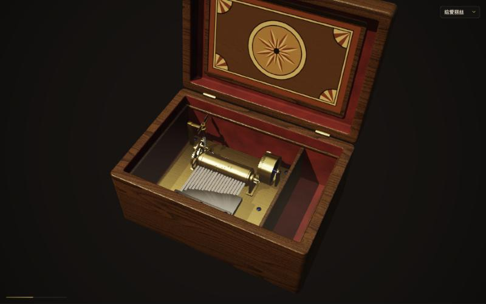

This post walks through how I built, together with Claude (Claude Code), a **photoreal music box that actually plays and shows how it works**: modelled in Blender, rendered in the browser with WebGPU. It is not a canned animation. The spring really stores energy, the governor really holds the speed steady, and every pin on the cylinder is placed from the score. When a pin passes under a steel tooth it lifts it and sets it vibrating, and at that same instant a synthesizer plays the matching note.

The second half lays out the mistakes we made along the way, screenshots of the broken versions included. Those mistakes turned out to be the most valuable part of working with an AI.

---

## 1. Goal: make the mechanism visible

A music box comes down to four things:

1. **Spring / power source**: winding it stores energy that drives the rotation.
2. **Cylinder (drum)**: its surface carries small pins arranged from the score, like a piece of code.
3. **Comb**: a row of steel teeth of different lengths; long teeth sound low, short teeth sound bright.
4. **Plucking**: as the cylinder turns, the pins pluck their teeth in order and the melody plays.

Those four points were all I gave Claude, plus two technical constraints: render with [vgpu](https://github.com/vercel-labs/vgpu) (a thin WebGPU library) and model with the Blender installed on my machine.

I chose to make it a **realistic showpiece**: visuals and sound first, with only light hover labels to explain the parts.

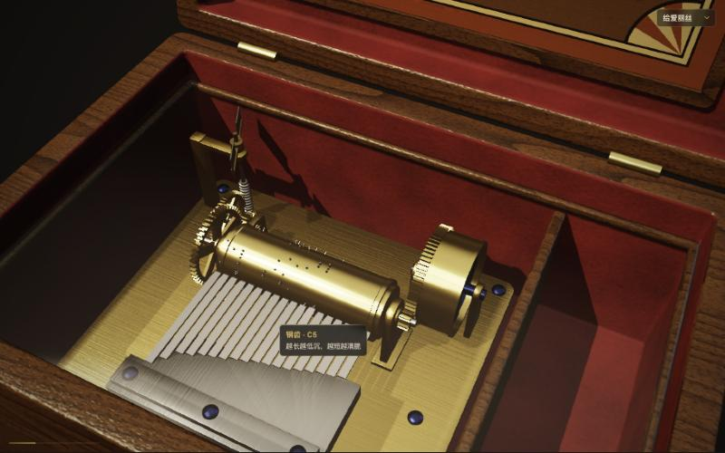

---

## 2. How we worked: design, then plan, then task-by-task implementation

Nothing in this project was written "while figuring it out". Claude moved in these steps, and each one waited for my confirmation:

1. **Clarify requirements.** It asked only the questions that changed the design: purpose (showpiece, teaching aid or toy), which tunes, where the sound comes from (live synthesis or samples), and how people interact with it.
2. **Propose an approach and write a design doc.** Of three options it recommended "Blender builds the static parts, the browser generates the pins and teeth from the score". The reason: **pin positions and note timing come from the same data**, so picture and sound line up by construction, and switching tunes never requires re-exporting the model.
3. **Implementation plan.** Twelve tasks, each with its files, interface signatures, test cases and the exact values to use (for example the MIDI pitches of the 18 teeth, or how much spring tension one revolution consumes).
4. **One subagent per task, plus an independent review.** Each task went to a fresh subagent that wrote failing tests first and then the implementation. Another subagent then reviewed only the diff. Problems went back to the implementer, and the fix was reviewed again. At the end there was a review of the whole branch.

One mechanism in this process I came to like a lot: **rulings**. However detailed a plan is, it contains contradictions and gaps. Instead of stopping to wait for me, Claude made the call itself and recorded what it decided, why, and what being wrong would cost. Then it handed me the whole list at the end. The project collected more than a dozen of these, for example:

- Reverse the cylinder's direction so the pins **lift the teeth from below**. The plan had them pressing down from above, which is the opposite of a real music box and contradicted the upward tooth vibration.
- When a glTF node has several materials, keep them grouped under one part instead of splitting them into fake "parts".
- Encode picking IDs (which part is under the mouse) in `rgba8unorm`, because vgpu's readback doesn't support integer formats.

The final repo has 23 commits, about 3,200 lines of TypeScript/WGSL, 1,265 lines of tests and a 1,435-line Blender script.

---

## 3. Blender: scripted modelling, not hand modelling

Every static part is generated by `blender/build_musicbox.py`, run headless:

```bash
/Applications/Blender.app/Contents/MacOS/Blender -b -P blender/build_musicbox.py -- --out public/musicbox.glb
```

The script:

- builds 13 parts with bmesh: case, lid, glass, brass bedplate, comb base, cylinder, bracket, spring barrel, spring coil, gear train, governor fan, key and felt. The part names double as IDs for rendering and picking.
- makes walnut, brushed brass, blued steel and velvet materials from procedural nodes, then **bakes them to textures** with Cycles (baseColor / normal / ORM) and embeds them in the glb, so the browser never has to understand Blender's node system.
- puts each moving part's origin on its axle and writes **the axis and the speed ratio relative to the cylinder** into the glTF extras, so the renderer can spin the parts directly.
- also writes `musicbox.meta.json`: the cylinder's position and radius, the positions and lengths of the 18 teeth, and the angle at which a pin meets a tooth tip. Tooth lengths follow 1/√f from the pitch and are **computed only once, in Blender**; the browser just reads them, so the two sides can never disagree.

To check the alignment, the script can also render a preview with temporary teeth and pins:

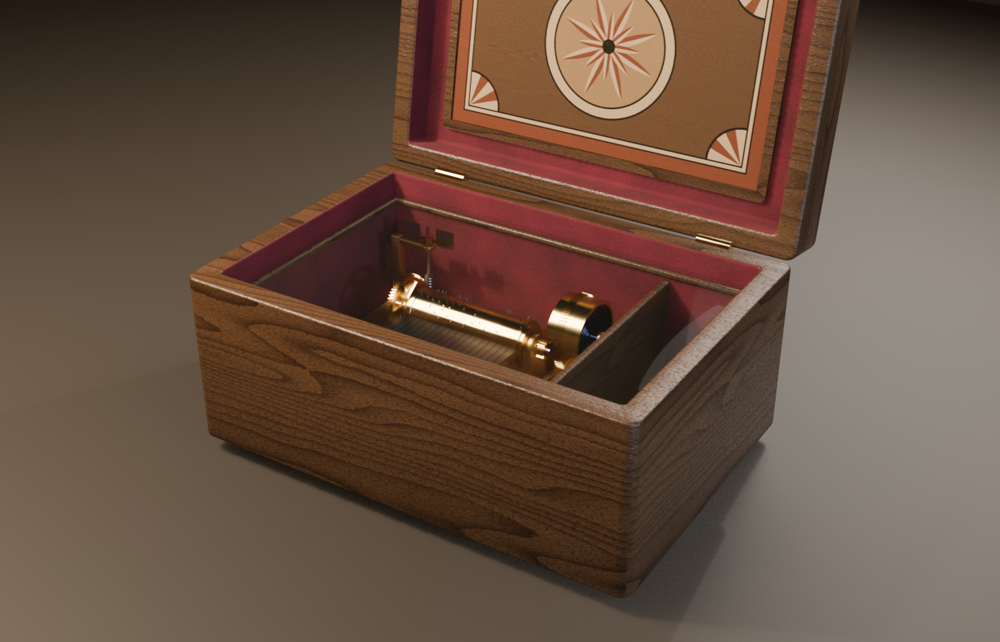

A small lesson: one bake takes about 20 minutes, so we later added a `--draft` flag that skips baking and exports right away. Geometry checks take seconds.

---

## 4. Rendering in the browser: vgpu + hand-written WGSL

vgpu is low-level. It gives you `geometry`, `draw`, `target` and camera helpers; the shaders and lighting are yours to write. It also **can't read glTF**, so step one was a small parser that supports exactly the kind of glb we export and fails loudly on anything else.

The first time the model appeared, it had only basic PBR (GGX microfacets):

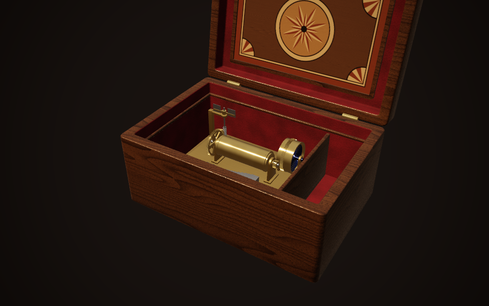

Next came **procedurally generated teeth and pins**. They are not in the glb; they are generated from the score and drawn instanced. Each pin stores just two numbers, the x position of its tooth and its starting angle. Following the cylinder's rotation happens entirely in the vertex shader.

The tooth vibration after a pluck also lives in the vertex shader. The root is fixed and the tip swings, with displacement decaying as `A · e^(−t/τ) · cos(2πft) · u²` (u runs from root to tip). High teeth vibrate faster and settle sooner. The 40 ms in which the pin pushes the tip up is a linear ramp.

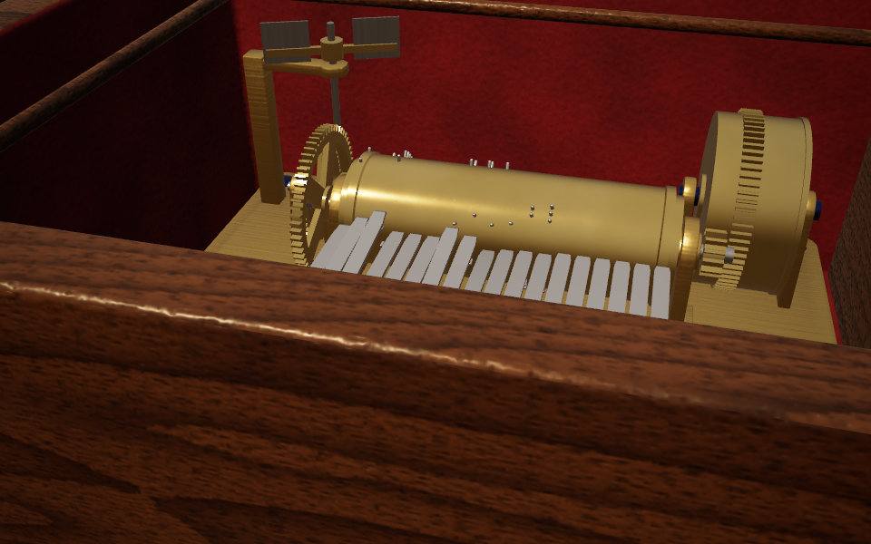

Then the three steps toward realism:

- **Shadows**: a 2048² depth map for one warm key light, with 3×3 PCF soft shadows. The key point is that the shadow pass reuses **the same vertex-deformation code**, so bending teeth, turning pins and the opening lid match exactly between shadow and picture.
- **Image-based lighting**: at startup a compute shader generates a warm interior environment and precomputes a diffuse irradiance map and a mip-filtered specular map. This is what finally made the steel teeth look like metal.
- **Glass**: drawn last with blending on and depth writes off, with a Fresnel term brightening the edges.

| Before shadows and IBL | After |
|---|---|
| 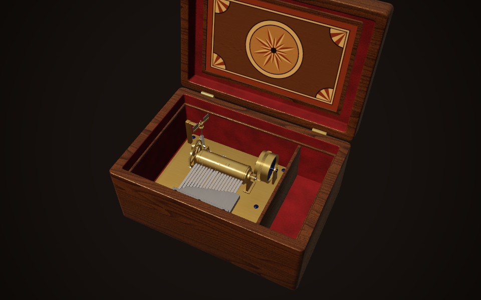 | 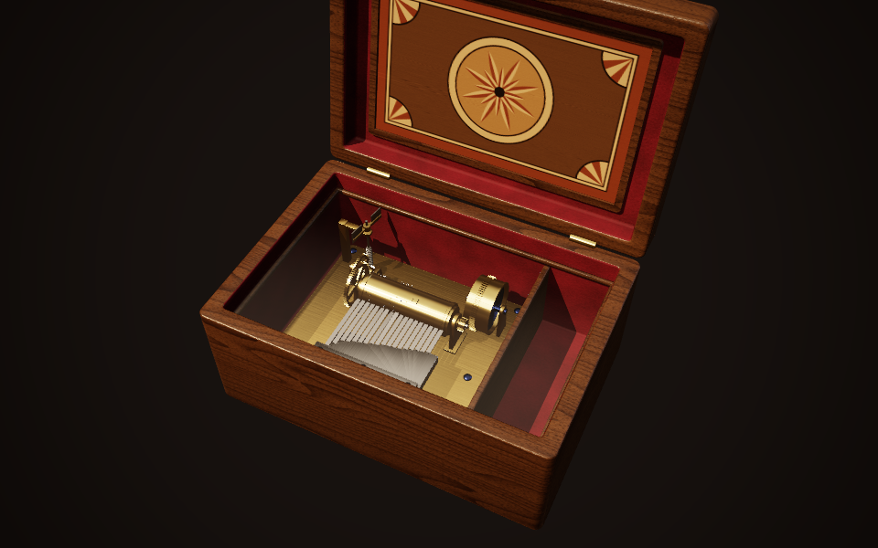 |

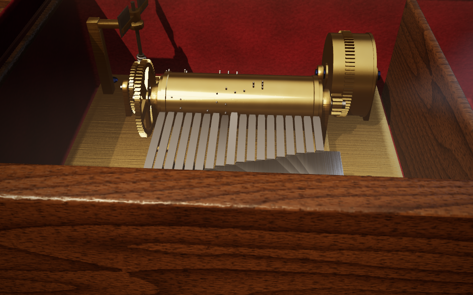

---

## 5. One score drives everything

The central design decision: **the score is the single source of truth**.

```ts
interface Song { bpm: number; beatsPerRevolution: number; notes: { beat: number; midi: number }[] }
```

- **Arrangement**: each note maps to one of the 18 teeth. A note outside the comb is shifted by octaves, and if it still doesn't fit, a test fails. There is also a hard rule that one tooth can't be plucked twice within 120 ms, since a real tooth needs time to settle; a test checks it for every tune.
- **Pin positions**: the pin for beat n sits at angle `2π · n / beatsPerRevolution` on the cylinder.
- **Mechanism timeline**: a pure-logic `Mechanism` module advances spring tension, speed and cylinder phase. It detects which pins crossed the pluck angle during each frame, interpolates the exact crossing time, and emits pluck events.

Both picture and sound only consume these events. So that sound can be queued ahead of time in Web Audio, the mechanism runs **50 ms ahead** of the picture, and the renderer rewinds the phase to the current moment. The frame in which a pin reaches a tooth tip is the frame in which you hear it.

---

## 6. Sound: synthesizing the steel tooth in real time

There are no recorded samples. Each note is four summed sine partials:

```ts
const PARTIAL_RATIOS = [1, 2.76, 5.40, 8.93];
```

These non-integer frequency ratios come from the vibration modes of a cantilever beam, and they are where the metallic "ting" comes from. Higher partials decay faster, and low notes ring longer, from about 3 s down to 0.8 s. All notes feed one bus, then pass through two peaking filters that imitate the wooden case's resonance, a short procedurally generated reverb, and a compressor.

Claude can't hear, so it checked the sound by rendering a tune offline with `OfflineAudioContext`. It measured peak level, looked for click-like sample jumps, and confirmed the first note's frequency: E5 should be near 659 Hz and measured about 670 Hz. Whether it sounds good is a job for human ears.

---

## 7. Interaction

- Drag to orbit, scroll to zoom, double-click to reset.
- **Orbit under the box and drag the key to wind it.** The key drives the spring through a ratchet, turns only one way, and gives a synthesized click every 30°.
- Click the lid to open or close it: opening starts the music, closing stops it immediately.
- Hover a part to see its name and what it does. Under the hood this is a 1×1-pixel ID pass that also reuses the vertex-deformation code, so even a vibrating tooth is picked accurately.

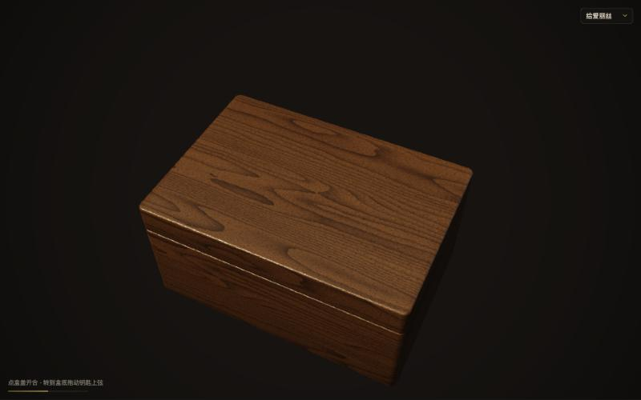

---

## 8. The mistakes we made

This is the part most worth recording. Every one of these mistakes had something in common: **all tests passed, and the result was still wrong**. Either the tests didn't cover it, or it simply wasn't something a test could catch.

### Mistake 1: the first note of every tune was silent

Pluck detection used a half-open interval `(p0, p1]`: when the phase moves from p0 to p1, pins crossed in between fire. That sounds fine. But when a tune starts, the cylinder phase is exactly 0 and the pin for beat 0 is also at 0. It is always "already crossed", so the first note after opening the lid was silent for every tune. At the time, a test even locked that behaviour in as correct.

Claude noticed it while checking the implementer's report, and a review subagent confirmed it. The rule became: the first advance after starting (or after switching tunes) uses the closed interval `[p0, p1]`.

### Mistake 2: pins pressing the teeth from above

The pin-angle formula in the plan made the cylinder turn so that the pins pressed the teeth down from above. But the tooth animation lifts upward, and on a real music box the pins lift the teeth from below. Before building the teeth and pins, Claude checked the coordinate conventions, spotted the contradiction, reversed the cylinder's direction, and used that convention in every later task.

### Mistake 3: the wind-down that either never ended or slammed to a stop

The design doc originally said that as the spring runs out, the speed falls along a smoothstep curve. After implementing it:

- Following the formula literally, the final slowdown dragged on for **36 seconds** without stopping.
- To shorten it, the cylinder was stopped once speed fell to 30%. That turned it into a **sudden brake**, and left some tension unspent.

In the final review Claude traced this back to the root. Near zero, smoothstep gives ω ∝ T², and tension is consumed at a rate proportional to ω. So T decays like 1/t over time and **never reaches 0 in finite time**. Any cutoff is either too long or too abrupt. The fix was:

```ts
omega = omega0 * Math.sqrt(Math.min(1, tension / slowdownTension));
```

With √T the speed falls to 0 at a constant deceleration and uses up exactly the remaining tension. Later, when a tune got much longer, the slowdown threshold was made to scale with each tune's speed, so every tune winds down in about 10 seconds.

### Mistake 4: a melody that was "completely wrong"

The fourth tune was one I added on a whim: *Waiting for a Thousand Years* (千年等一回), the theme song of the 1992 Chinese TV series *New Legend of Madame White Snake*. Note that it is not in the public domain. The repo contains only the melody's note data, no lyrics; if you publish something similar, you need to handle the rights yourself.

The first version was written from a numbered-notation score (jianpu) I had pasted in casually. That score was inaccurate and had no durations, so Claude guessed the rhythm. Every test passed, but one listen told me it was completely wrong.

For the second version I asked Claude to find the original singer's score online. It zoomed in until the octave dots and rhythm underlines were legible, and read pitches and durations bar by bar. While reading, it noticed that the original key (G) needed two notes the 18-tooth comb doesn't have, so it **transposed the whole tune to F**, putting every melody note on the comb. This time it also added a test that compares the whole melody note by note against the score, so it can't silently break later.

The lesson: **an AI can guarantee "matches the score it was given", but not that the score it was given is right.** Listening is a check only a human can do.

### Mistake 5: gears that never meshed

Near the end I zoomed in on the movement and saw a gap between the spring barrel's ring gear and the cylinder's pinion. Power was reaching the cylinder through thin air:

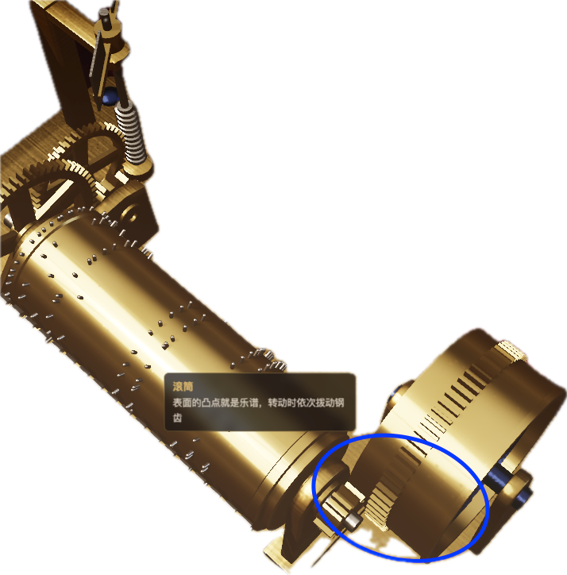

There turned out to be three problems:

1. The pinion and the ring gear were **offset about 0.7 mm along the axle**, so they were never in the same plane.
2. The tooth ratio was 72:12 (6:1), but the animation turned the barrel at 1/8 speed, and the two gears' radii had been chosen independently, so they couldn't mesh even if aligned.
3. In the stage from the cylinder to the governor fan, the direction of the meshing external gears was reversed, and the speed ratio didn't match the tooth counts either.

The fix turned "looks like a gear" into "computed by the rules of gearing". Each meshing pair now shares one module m, the pitch radius is r = m·N/2, and the two pitch radii add up to the centre distance. Animation speed ratios are derived directly from the tooth counts. Starting phases are set from the direction of the contact point, so a pinion tooth faces a gap in the larger gear. Finally, a script checked numerically that over a full revolution the teeth always keep about 0.1 mm of clearance: engaged, but never passing through each other.

The same camera before and after (top view, cylinder at bottom left, spring barrel at top right):

| Before: the pinion sits entirely to the left of the ring gear | After: both mesh in the same plane |
|---|---|
| 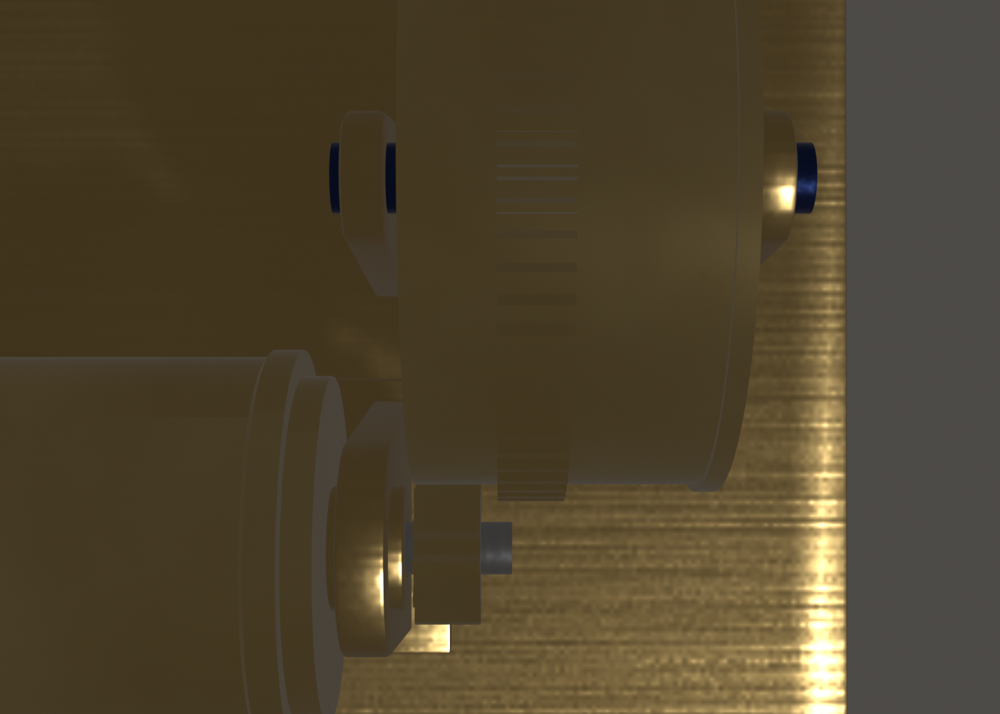 | 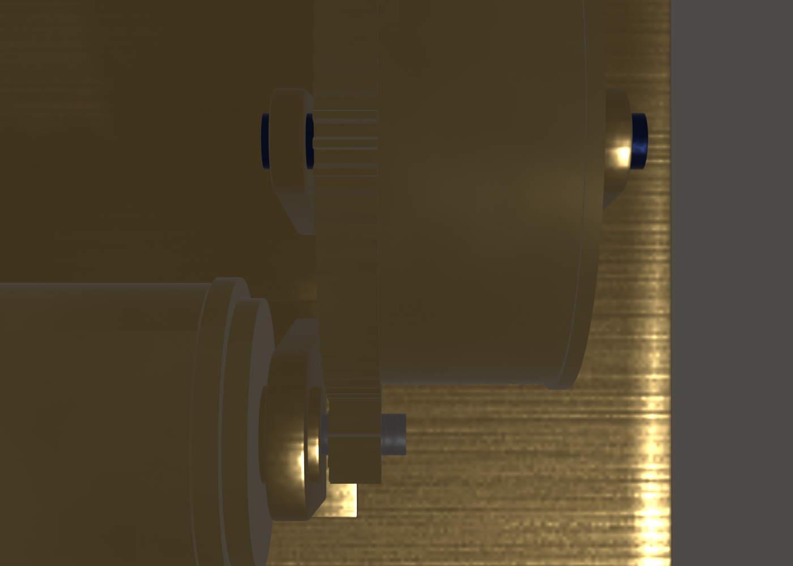 |

The same spot in the live app after the fix:

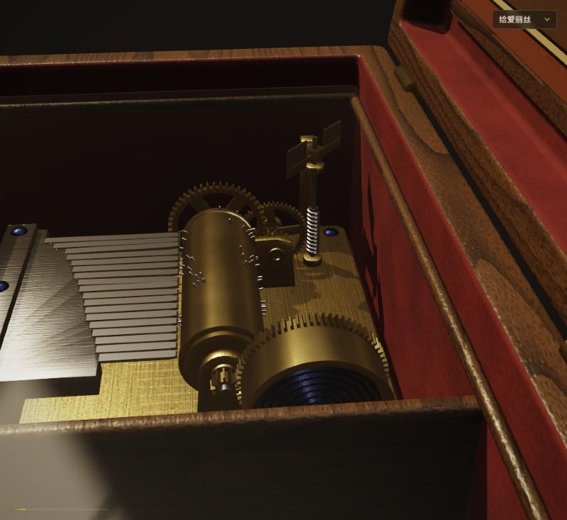

For this post, the buggy version is tagged [`v0.1-gear-misaligned`](https://github.com/here-there/claude-blender-music-box/tree/v0.1-gear-misaligned) in git, so you can check it out and reproduce it any time.

---

## 9. Takeaways

1. **Turn requirements into things that can be verified.** Pin positions, pluck times, tooth spacing, wind-down length, gear clearance: everything that could be written as a number became a test or a numeric check. Claude almost never got those wrong.
2. **Humans do the looking and the listening.** Two of the five mistakes (the wrong melody and the unmeshed gears) I caught with one look or one listen, exactly when every test was green. An AI can take screenshots and analyse audio offline, but "does this look right, does this sound good" still needs a person.
3. **Have the AI write its decisions down.** Plans always contain contradictions. Rather than stopping to ask, let it rule, record the reason and the cost, and review the list at the end. This is far more efficient than back-and-forth confirmation, and you know exactly which decisions it made on your behalf.
4. **Independent review pays off.** Things the implementer's self-check considered fine were often obvious to a reviewer who saw only the diff (that is how the silent first note was caught).
5. **Script Blender instead of modelling by hand.** The model is reviewed and rolled back together with the code, and fixing a gear means changing a few constants and re-exporting.

---

## Appendix: running it, and the layout

```bash
pnpm install
pnpm dev      # local preview (needs a WebGPU browser: desktop Chrome / Edge 113+)
pnpm test     # unit tests
pnpm model    # regenerate public/musicbox.glb with Blender
```

- `blender/`: modelling script, fixed-camera close-up render script
- `src/songs/`: scores and arrangement
- `src/mechanism/`: spring, governor and pluck timeline
- `src/render/`: vgpu rendering and WGSL shaders
- `src/audio/`: steel-tooth sound synthesis
- `src/interaction/`: camera, winding, lid, hover labels

Live demo: [study.geobridge.cn/webgpu/music-box](https://study.geobridge.cn/webgpu/music-box/)
