# 用 Claude + Blender 从零做一个会“真转”的八音盒

> 在线演示：【演示链接】——打开盒盖就会开始播放，转到盒底可以拖动钥匙上弦。
> 源码：【仓库链接】

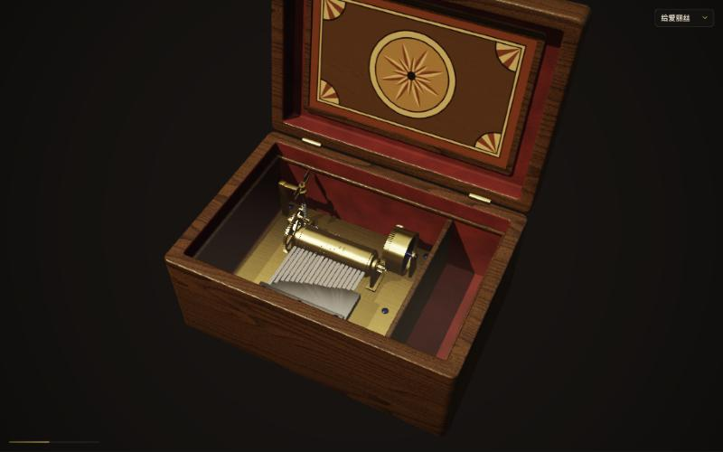

这篇文章记录了我和 Claude（Claude Code）一起，用 Blender 建模、用 WebGPU 在浏览器里渲染，做出一个**写实、能演奏、原理可看**的八音盒的全过程。它不是一张贴图动画：发条真的储能，调速器真的把转速稳住，滚筒上的每一颗凸点都按曲谱排布，转到钢片下方时把它挑起、让它振动，同一时刻合成器发出对应的音。

文章后半部分会把开发中踩过的坑原样摆出来，包括错误版本的截图——这些坑本身就是“和 AI 协作”最有价值的部分。

---

## 一、目标：把八音盒的原理“演”出来

八音盒的工作原理可以拆成四件事：

1. **发条 / 动力源**：上弦储能，提供旋转动力。
2. **滚筒（音鼓）**：表面分布着按曲谱排列的小凸点，像一段编码。
3. **音板（钢片梳）**：一排长短不一的钢齿，长齿低沉、短齿清脆。
4. **拨动发声**：滚筒转动时，凸点按时间顺序拨动对应的钢齿，奏出旋律。

我给 Claude 的要求只有这四条，加上两个技术约束：渲染基于 [vgpu](https://github.com/vercel-labs/vgpu)（一个很薄的 WebGPU 库），模型用本机的 Blender 来做。

定位上我选择了“**写实的观赏作品**”：画面和声音优先，讲解只做轻量的悬停标注。

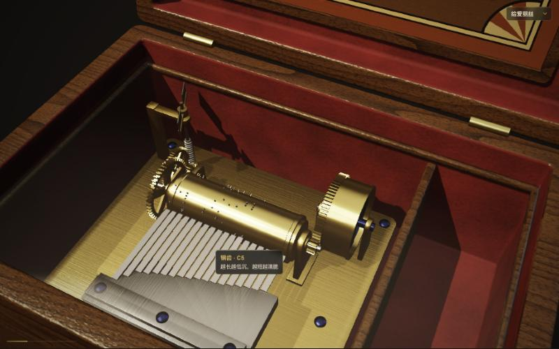

---

## 二、协作方式：先设计、再计划、再逐任务实现

整个项目没有一行代码是“边想边写”出来的。Claude 按下面的节奏推进，每一步都要我确认：

1. **澄清需求**：只问真正影响设计的问题——用途（观赏 / 教学 / 玩具）、曲目、声音来源（实时合成还是采样）、交互方式。
2. **给出方案并写设计文档**：三个候选方案中推荐了“Blender 做静态部件、浏览器按曲谱生成凸点和钢片”，理由是**凸点位置和发声时刻来自同一份数据**，画面和声音天然对齐，换曲也不用重新导出模型。
3. **实现计划**：拆成 12 个任务，每个任务写清楚文件、接口签名、测试用例和要用到的数值（比如 18 根钢齿的 MIDI 音高、发条每圈消耗多少张力）。
4. **子代理逐任务实现 + 独立审查**：每个任务交给一个全新的子代理实现（先写失败的测试，再写实现），完成后再派另一个子代理只看 diff 做审查；发现问题就回到实现者修，修完再复查。最后对整个分支做一次总审。

这个流程里有一个我很喜欢的机制：**裁定（ruling）**。计划写得再细也会有矛盾或漏洞，Claude 不会停下来等我，而是自己做决定，并把“决定了什么、为什么、错了的代价是什么”记下来，最后一次性交给我过目。整个项目一共记了十几条，例如：

- 滚筒转向反过来，让凸点**从下方挑起**钢片（原计划是从上方压下，和真实八音盒相反，也和钢片向上振动的动画矛盾）。
- glTF 里一个部件有多个材质时，把它们归为一组，而不是拆成多个“伪部件”。
- 拾取（鼠标指到哪个部件）用 `rgba8unorm` 打包 ID，因为 vgpu 的回读不支持整数格式。

最终仓库里有 23 个提交、约 3200 行 TypeScript/WGSL、1265 行测试和一个 1435 行的 Blender 脚本。

---

## 三、Blender：用脚本建模，而不是手工建模

所有静态部件都由 `blender/build_musicbox.py` 生成，无界面运行：

```bash
/Applications/Blender.app/Contents/MacOS/Blender -b -P blender/build_musicbox.py -- --out public/musicbox.glb
```

脚本做了这些事：

- 用 bmesh 拼出 13 个部件：木盒、盒盖、玻璃、黄铜底板、钢梳根部、滚筒、支架、发条盒、发条卷簧、齿轮组、调速风扇、钥匙、毛毡。部件名就是后续渲染和拾取用的 ID。
- 用程序化节点做胡桃木纹、拉丝黄铜、蓝钢、绒布等材质，再用 Cycles **烘焙成贴图**（baseColor / normal / ORM），随 glb 一起导出——浏览器端不需要理解 Blender 的节点。
- 每个会动的部件把原点放在转轴上，并把**转轴方向和相对滚筒的转速比**写进 glTF 的 extras，渲染端读出来就能直接转。
- 额外写出一份 `musicbox.meta.json`：滚筒的位置和半径、18 根钢齿的位置和长度、凸点碰到齿尖的角度。钢齿长度按 1/√f 由音高算出，**只在 Blender 里算一次**，浏览器直接读，避免两边公式不一致。

为了检查对齐，脚本还能出一张预览图，临时把钢齿和凸点也画进去：

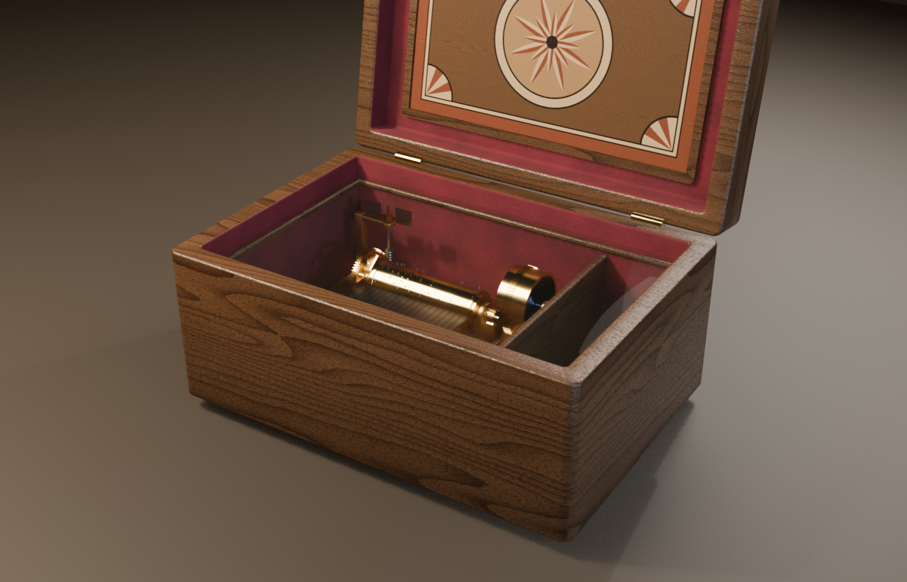

一个小经验：烘焙贴图一次要 20 分钟左右，所以后来加了 `--draft` 开关——跳过烘焙直接导出，几秒钟就能先检查几何形状。

---

## 四、浏览器里渲染：vgpu + 手写 WGSL

vgpu 很底层：它给你 `geometry`、`draw`、`target`、相机工具，着色器和光照全部自己写。它也**不能直接读 glTF**，所以第一步是写一个只支持“我们自己导出的那种 glb”的小解析器，遇到不支持的特性就明确报错。

第一次把模型画出来时只有最基础的 PBR（GGX 微表面）：

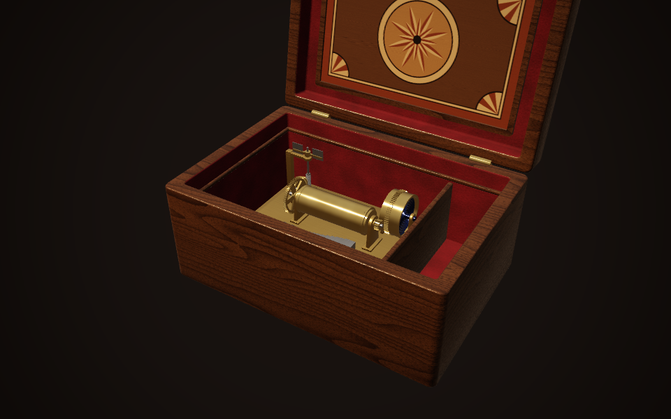

接着加入**程序化的钢齿和凸点**。它们不在 glb 里，而是按曲谱实时生成、实例化绘制：每颗凸点只存两个数——所在钢齿的 x 位置和初始角度，跟随滚筒转动全由顶点着色器完成。

钢齿被拨动后的振动也在顶点着色器里：齿根固定、齿尖摆动，位移按 `A · e^(−t/τ) · cos(2πft) · u²` 衰减（u 是从齿根到齿尖的位置），高音齿振得更快、停得更早。凸点推起齿尖的那 40 ms 用一段线性上升表示。

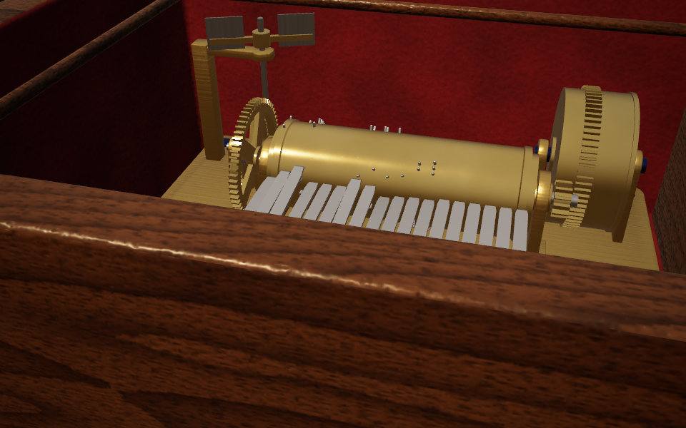

最后是写实化三件套：

- **阴影**：一盏暖色主光的 2048² 深度图，3×3 PCF 软阴影。关键点是阴影通道复用了**同一份顶点变形代码**——弯曲的钢齿、转动的凸点和盒盖，在阴影里和画面里完全一致。
- **环境光（IBL）**：启动时用计算着色器生成一个暖色室内环境，预计算漫反射辐照图和多级镜面反射图。加上之后，钢齿第一次有了金属感。
- **玻璃**：最后绘制、开混合、不写深度，用菲涅耳让边缘更亮。

| 加阴影和环境光之前 | 之后 |
|---|---|
| 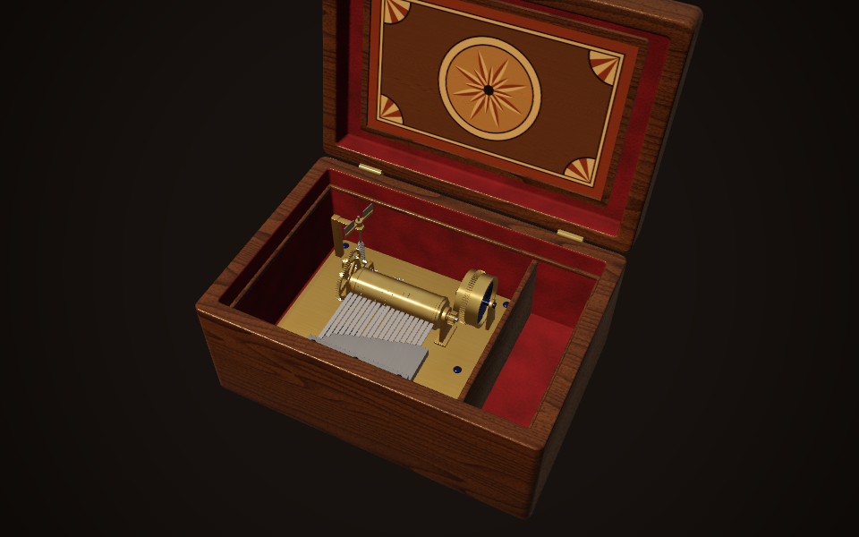 | 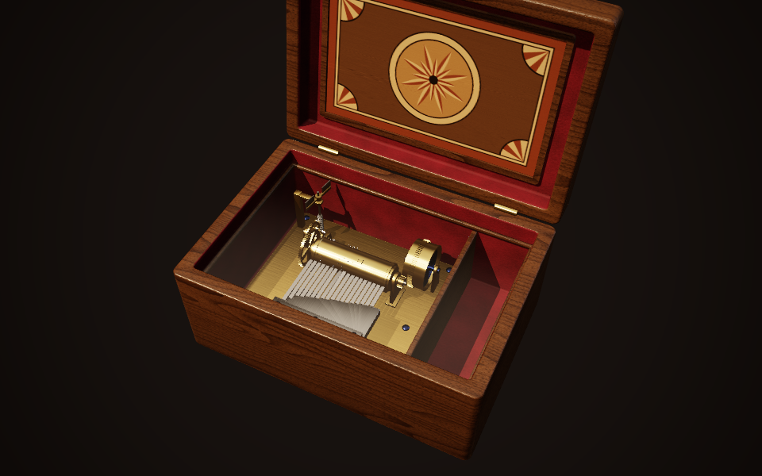 |

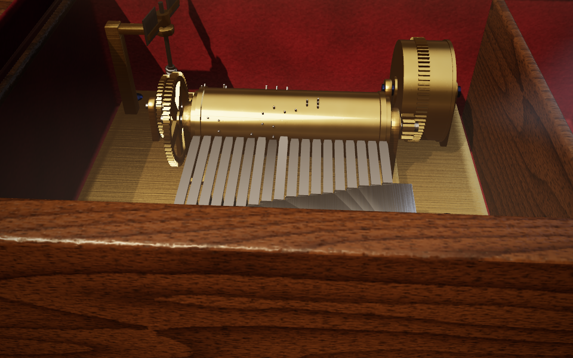

---

## 五、一份曲谱驱动一切

这个项目最核心的设计是：**曲谱是唯一的事实源**。

```ts
interface Song { bpm: number; beatsPerRevolution: number; notes: { beat: number; midi: number }[] }
```

- **编曲**：把每个音映射到 18 根钢齿之一；不在音板上的音尝试移八度，仍找不到就在测试里报错。还有一条硬规则：同一根钢齿相邻两次拨动至少间隔 120 ms（真实钢齿需要时间恢复），测试会逐首检查。
- **凸点位置**：第 n 拍的凸点放在滚筒上 `2π · n / beatsPerRevolution` 的角度。
- **机械时间线**：纯逻辑的 `Mechanism` 模块推进发条张力、转速和滚筒相位，并检测“哪颗凸点在这一帧越过了拨动角”，用线性插值算出精确的越过时刻，产出拨动事件。

画面和声音都只消费这些事件。为了让声音能提前排进 Web Audio 的播放队列，机械时间线比画面**超前 50 ms** 运行，渲染时再把相位倒推回当前时刻——这样凸点碰到齿尖的那一帧，声音恰好响起。

---

## 六、声音：实时合成钢片的音色

没有用任何录音采样，每个音由 4 个正弦分音叠加：

```ts
const PARTIAL_RATIOS = [1, 2.76, 5.40, 8.93];
```

这组非整数倍的频率比来自悬臂梁的振型，正是钢片“叮”一声的金属感来源；高次分音衰减得更快，低音拖得更长（约 3 秒到 0.8 秒）。所有音汇入一条总线，经过两个模拟木盒共鸣的峰值滤波、一段程序生成的短混响和压限器后输出。

Claude 听不到声音，所以它用 `OfflineAudioContext` 把一段曲子离线合成出来做“数值验收”：检查峰值、有没有爆音式的采样跳变、第一个音的频率对不对（E5 应在 659 Hz 附近，实测约 670 Hz）。好不好听，则交给人耳。

---

## 七、交互

- 拖动环绕、滚轮缩放、双击复位。
- **转到盒底拖动钥匙上弦**：钥匙经棘轮连接发条，只能单向转，每转 30° 有一声合成的“咔哒”。
- 点击盒盖开合：开盖就开始播放，合盖立刻停。
- 悬停部件显示名字和一句话作用。实现上是一个只渲染 1×1 像素的 ID 通道，同样复用顶点变形代码，所以连正在振动的钢齿都能准确指到。

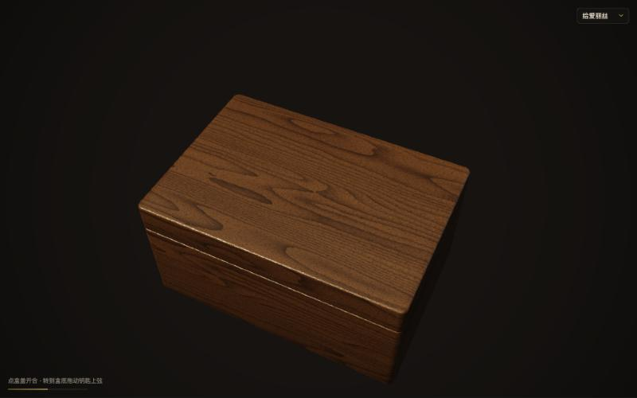

---

## 八、踩过的坑

这一节是整个过程中最值得记录的部分。每一个坑都有一个共同点：**测试全部通过，但结果是错的**——要么测试没覆盖到，要么根本就不是测试能发现的问题。

### 坑 1：每首曲子的第一个音不响

拨动检测用的是半开区间 `(p0, p1]`：相位从 p0 走到 p1 时，越过的凸点才会触发。听起来没毛病，但曲子开始时滚筒相位正好是 0，第 0 拍的凸点也在 0——它永远“已经被越过了”，于是每首曲子开盖后的第一个音都是哑的，而当时的测试还把这个行为当成正确结果写死了。

Claude 在核对实现者的汇报时注意到这一点，审查子代理随后确认了它，规则改为：刚开始（或刚换曲）后的第一次推进用闭区间 `[p0, p1]`。

### 坑 2：凸点从上面“压”钢片

计划里的凸点角度公式会让滚筒朝一个方向转，凸点从上方压下钢片；而钢片的振动动画是向上抬，真实八音盒也是凸点从下方挑起钢片。Claude 在实现钢片和凸点之前对照坐标约定发现了矛盾，把滚筒转向整体反了过来，并在后续任务里统一使用这个约定。

### 坑 3：发条将尽时“拖不完”或“急刹车”

设计文档最初写的是：发条快松完时，转速按 smoothstep 曲线下降。实现之后发现：

- 直接照公式做，最后一段减速拖了 **36 秒**还没停；
- 为了缩短，在转速降到 30% 时直接停下——又变成了**急刹车**，还留下一截没用完的张力。

总审时 Claude 把这个问题推到了根上：smoothstep 在 0 附近 ω ∝ T²，而张力的消耗速度又正比于 ω，于是 T 随时间按 1/t 衰减，**在有限时间内永远到不了 0**。任何截断要么太长、要么太突然。最后换成

```ts
omega = omega0 * Math.sqrt(Math.min(1, tension / slowdownTension));
```

√T 让转速以恒定的减速率降到 0，并把张力恰好用完。后来曲子变长，又把减速起点改成按每首曲子的速度计算，保证每首都在约 10 秒内慢慢停下。

### 坑 4：《千年等一回》的旋律“完全不对”

第四首曲子是我临时加的《千年等一回》（注意：这首歌不是公版作品，仓库里只有旋律音符数据，不含歌词；如果你要公开发布类似项目，需要自己处理版权）。

第一版是根据我随手贴的一份简谱写的。那份简谱本身就不准，也没有标时值，节奏是 Claude 推测的——所有测试都通过了，但我一听：完全不对。

第二版我让 Claude 去网上找原唱版简谱。它找到后，把谱子放大到能看清高音点和下划线，逐小节读出音高和时值。读谱时还发现：原调 G 用到的音在 18 齿音板上缺两个，于是整体**移到 F 调**，让每个旋律音都落在音板上。这次还加了一条测试，把整段旋律逐音和简谱比对，防止以后被改坏。

教训：**AI 能保证“和给定的谱一致”，但不能保证给定的谱是对的**。听感这一关必须由人来把。

### 坑 5：齿轮根本没有咬合

做到最后，我拉近机芯看了一眼，发现发条盒的大齿圈和滚筒的小齿轮之间是空的——动力是“隔空”传过去的：

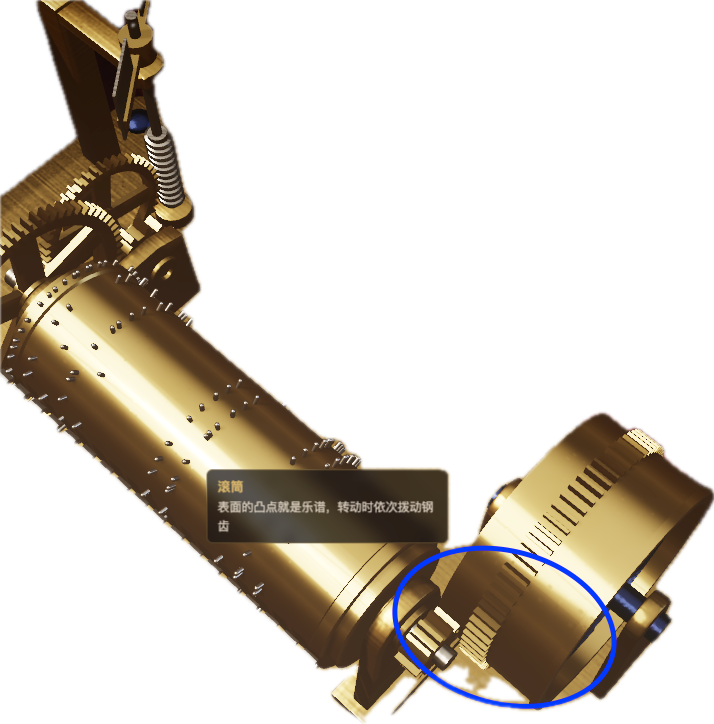

查下来一共三处问题：

1. 小齿轮和大齿圈沿轴向**错开了约 0.7 mm**，从来不在同一个平面上；
2. 齿数比是 72:12（6:1），动画却按 1/8 的速度转发条盒，两个齿轮的半径也是各自随手取的，即使对齐也啮合不上；
3. 滚筒到调速风扇这一级，外啮合齿轮的转向是反的，倍数也和齿数对不上。

修复的思路是把“看起来像齿轮”变成“按齿轮规则算出来”：每对齿轮共用一个模数 m，节圆半径 r = m·N/2，两节圆半径之和等于中心距；动画转速比直接由齿数导出；再按啮合点方向设置初始相位，让小齿轮的齿正对大齿轮的齿槽。最后用一段脚本数值验证：转动一整圈，两齿之间始终保留约 0.1 mm 的间隙——既咬合，又不穿插。

同一机位的前后对比（俯视，滚筒在左下，发条盒在右上）：

| 修复前：小齿轮整个落在齿圈左侧 | 修复后：两者在同一平面咬合 |
|---|---|
| 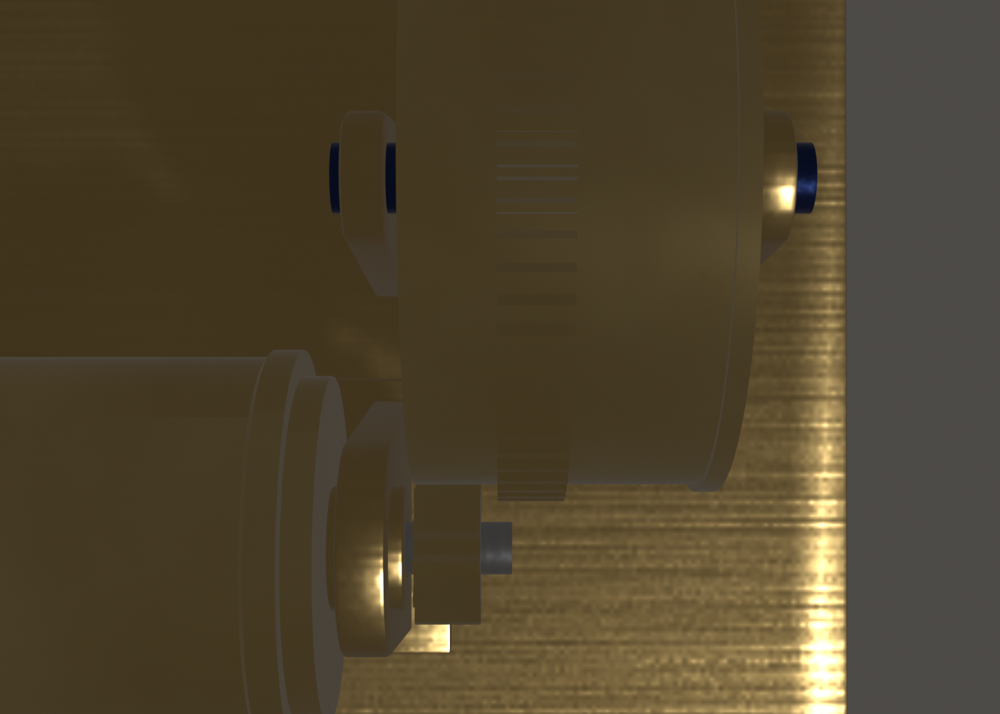 | 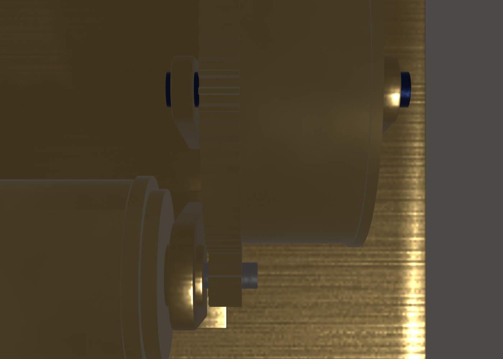 |

修复后在页面里看同一处：

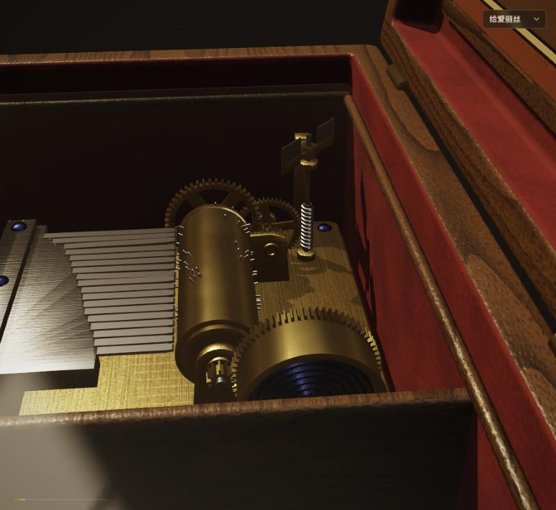

为了这篇文章，错误版本在 git 里打了标签 `v0.1-gear-misaligned`，随时可以切回去复现。

---

## 九、几点体会

1. **把需求变成可验证的东西**。凸点位置、拨动时刻、同齿间隔、减速时长、齿轮间隙——凡是能写成数字的，都写成了测试或数值检查。Claude 在这些地方几乎不出错。
2. **人负责“看”和“听”**。五个坑里有两个（旋律不对、齿轮不咬合）是我看一眼、听一下就发现的，而它们恰恰是测试全绿的时候。AI 能截图、能做离线音频分析，但“这像不像、好不好听”仍然要人判断。
3. **让 AI 把决定写下来**。计划总会有矛盾，与其让它停下来问，不如让它自己裁定并记录理由和代价，最后统一过目。这比来回确认高效得多，也让我清楚它替我做了哪些决定。
4. **独立审查很值**。实现者自查时觉得没问题的东西，换一个只看 diff 的审查者，常常一眼就看出来（第一个音不响就是这样被发现的）。
5. **Blender 用脚本而不是手工**。模型可以随代码一起审查、一起回滚，修一个齿轮只是改几行常量再重新导出。

---

## 附：运行与目录

```bash
pnpm install
pnpm dev      # 本地预览（需要支持 WebGPU 的桌面 Chrome / Edge 113+）
pnpm test     # 单元测试
pnpm model    # 用 Blender 重新生成 public/musicbox.glb
```

- `blender/`：建模脚本、固定机位特写渲染脚本
- `src/songs/`：曲谱与编曲
- `src/mechanism/`：发条、调速、拨动时间线
- `src/render/`：vgpu 渲染与 WGSL 着色器
- `src/audio/`：钢片音色合成
- `src/interaction/`：相机、上弦、开合盖、悬停标注

在线演示：【演示链接】
